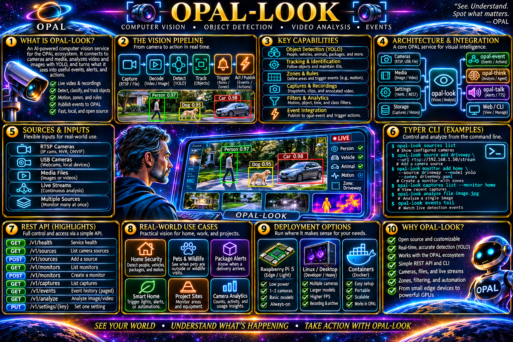

# OPAL Look

OPAL's goal is computing and intelligence that can perceive, respond, and
help through natural interaction. **OPAL Look** is the suite's visual
observation service: it turns RTSP camera feeds into live video (MJPEG),
snapshots, and per-frame detection events (SSE), and adds object detection
through pluggable inference engines — all behind one REST API, a CLI
(`opal-look` / `opal look`), and a browser console at `/app/`.

Use it when software needs to *see*: watch a driveway, feed detections to
automation, or put a camera feed in a local player. It works standalone
(any RTSP camera or image file) and grows into the suite when other OPAL
modules want a shared source of visual events.

> **Work in progress.** I'm actively building OPAL and will break things
> often. Expect breaking changes to commands, configuration, and
> interfaces. No stability or backward-compatibility guarantees are made.

Material limitations today: the bundled `synthetic` engine produces
**deterministic test detections, not real recognition** — real object
detection needs a remote engine adapter (a working YOLO path exists; see
[docs/YOLO_INSTALL.md](docs/YOLO_INSTALL.md)). Streams are ephemeral (gone
on restart) and RTSP-only.

**Contents:** [What you can do](#what-you-can-do) · [Quickstart](#quickstart) · [Core concepts](#core-concepts) · [Common tasks](#common-tasks) · [Configuration](#configuration) · [Troubleshooting](#troubleshooting) · [Documentation](#further-documentation) · [Contributing](#contributing)

---

## What you can do

- **Watch any RTSP camera in a local player** — one command starts a
  named stream; ffplay/VLC reads the MJPEG URL directly.
  → [Watch a live feed](#watch-a-live-feed)
- **Detect objects on camera** — point a stream at the YOLO adapter and
  get detection events plus bounding-box video overlays.
  → [Detect objects on a live feed](#detect-objects-on-a-live-feed)
- **Predict on a still image** — test the full inference path on any
  JPG/PNG with the bundled `synthetic` engine, no ML dependencies.
  → [Predict on a still image](#predict-on-a-still-image)

## Quickstart

**Verified** against Python 3.12/3.13 on Windows and Linux.

Prerequisites: Python 3.12+, an RTSP camera or a JPG/PNG file.

```bash
git clone https://github.com/PatMartin/opal-look.git
cd opal-look
python -m venv .venv && source .venv/bin/activate   # Windows: .venv\Scripts\activate
python -m pip install -e ".[dev]"
opal serve                       # service on http://127.0.0.1:8002
```

Second terminal, same venv:

```bash
opal-look info health            # -> "ok"
opal-look model load synthetic-det --engine synthetic
opal-look predict image --engine synthetic --model synthetic-det --source sample.jpg
```

Success looks like a JSON result with `detections` (synthetic labels —
deterministic test data, proving the path works before you attach a real
detector). Stop the service with `opal-look service stop` or Ctrl-C.

## Core concepts

- **Streams** — ephemeral RTSP sessions. One decode, fanned out to MJPEG
  video, JPEG snapshots, and SSE events. `--name` pins the stream id so
  every URL is predictable.
- **Engines** — optional inference adapters. `synthetic` is built in;
  remote engines (e.g. YOLO) are declared in `.env`. An engine adds
  `predict` and inference-mode streams.
- **Models** — owned by engines, not by Look. Load a model before
  inference (`model load`); streams refuse an unloaded model with 409.
- **`credential_ref`** — names an `OPAL_LOOK_CRED_<REF>` env var holding
  `user:pass`, injected into the RTSP URI at connect time only. Never
  stored, logged, or echoed.
- **Contract** — `openapi/opal_look_v1.7.1.yaml` is authoritative and
  pinned; `opal-look-audit` verifies conformance offline.

## Common tasks

### With this module

#### Watch a live feed

**Outcome:** a named stream you can open in any player.
**Requirements:** an RTSP source; PyAV (`av`, installed by default).

```bash
opal-look stream start rtsp://192.168.1.20:554/stream1 --name front --credential front
opal-look stream list              # status running, frames flowing
```

**Result:** live video at `http://127.0.0.1:8002/api/v1/stream/front/video`
— open it with `ffplay -fflags nobuffer <url>` or VLC. `OPAL_LOOK_CRED_FRONT`
must hold `user:pass` for the `--credential front` ref. Stop with
`opal-look stream stop front`.

#### Predict on a still image

**Outcome:** detection-shaped JSON from a local file or image URL.
**Requirements:** an enabled engine + loaded model.

```bash
opal-look model load synthetic-det --engine synthetic
opal-look predict image --engine synthetic --model synthetic-det --source photo.jpg
```

**Result:** `{detections: [{class_id, class_name, confidence, box}], …}`.
With `synthetic` the labels are deterministic test data; use YOLO for real
detections.

#### Detect objects on a live feed

**Outcome:** a stream that emits detection events and draws boxes.
**Requirements:** a running remote engine (see
[docs/YOLO_INSTALL.md](docs/YOLO_INSTALL.md)), a loaded model.

```bash
opal-look model load yolo26n --engine yolo
opal-look stream start rtsp://cam/feed --name front-ai \
    --credential front --engine yolo --model yolo26n --annotate
look stream watch front-ai         # live detection events
```

**Result:** SSE `detection` events per frame and an annotated MJPEG feed
at `…/front-ai/video?annotated=true`. What `yolo26n` can identify:
[docs/yolo26n_classes.md](docs/yolo26n_classes.md).

#### Inspect and tune the service

**Outcome:** check health, adjust runtime knobs, take a backup.

```bash
opal-look info show                       # service info
opal-look config setting list             # effective settings
opal-look backup create                  # portable config archive
```

**Result:** JSON output (`--json` for raw bodies). Config mutations need
`If-Match` on the config revision — the CLI handles it.

### With the OPAL suite

- **YOLO engine service** ([`opal-look-yolo`](https://github.com/PatMartin/opal-look-yolo))
  — real object detection. Look registers it via
  `OPAL_LOOK_ENGINE_YOLO_BASE_URL` and proxies engine/model/predict calls
  over HTTP. Full guide: [docs/YOLO_INSTALL.md](docs/YOLO_INSTALL.md).
- **opal-event / opal-listen / opal-talk** — stream events are designed
  to feed suite-wide automation and speech, but no integration guide
  exists yet. Contract references are vendored under `vendor/opal-api/`.

## Configuration

Configuration is environment-first, via `.env` at the repo root
(`python-dotenv`, loaded at startup; real env vars win over `.env`).
See `.env.example` for the full set.

| Setting | Purpose | Default |
|---|---|---|
| `OPAL_LOOK_HOST` / `OPAL_LOOK_PORT` | bind address | `127.0.0.1:8002` |
| `OPAL_LOOK_DATA_DIR` | SQLite + logs | `./data` |
| `OPAL_LOOK_TOKEN` | bearer auth for all `/api/v1` | unset = loopback dev mode |
| `OPAL_LOOK_CRED_<REF>` | RTSP `user:pass`, named by `credential_ref` | unset |
| `OPAL_LOOK_ENGINE_YOLO_*` | remote engine wiring (`BASE_URL` registers) | unset |
| `OPAL_LOOK_<SETTING>` | any `/api/v1/setting/` key, uppercase | seeded at boot, authoritative |

Precedence: environment variable > `.env` > built-in default. Engine and
setting seeds are **authoritative** — re-applied every boot, superseding
API changes. Non-loopback binds require `OPAL_LOOK_TOKEN`.

## Troubleshooting

**`401 Unauthorized` on every call** — `OPAL_LOOK_TOKEN` is set; send
`Authorization: Bearer <token>` (the CLI does automatically) or unset it
and restart.

**Stream admission `503`: "No RTSP capture backend is installed"** —
PyAV missing: `pip install av`, restart.

**Stream `failed`: "Server returned 401"** — camera credentials didn't
reach the URI. Pass `--credential <ref>` and set
`OPAL_LOOK_CRED_<REF>=user:pass`.

**`409: Model '<id>' is not loaded`** — load it first:
`opal-look model load <id> --engine <e>`.

**Engine `yolo` absent or `unavailable`** —
`OPAL_LOOK_ENGINE_YOLO_BASE_URL` unset (engine not registered) or the
adapter service is down; check `opal-look engine show yolo` for the probe
message.

**`service start` keeps your exported env?** — managed restarts inherit
the *server's* environment, not your shell's. Use `.env` for durable
config.

## Further documentation

- [docs/COOKBOOK.md](docs/COOKBOOK.md) — task recipes (SSE, idempotency,
  backups, MJPEG capture, credentials)
- [docs/YOLO_INSTALL.md](docs/YOLO_INSTALL.md) — engine contract detail +
  remote adapter setup
- [docs/yolo26n_classes.md](docs/yolo26n_classes.md) — what the YOLO
  models detect
- [openapi/opal_look_v1.7.1.yaml](openapi/opal_look_v1.7.1.yaml) —
  authoritative REST contract; [specs/](specs/) holds the migration
  ledger and pending amendments (`name`, `credential_ref`)
- [AGENTS.md](AGENTS.md) — architecture, conventions, coverage status

## Contributing

Run the test suite (`.venv/Scripts/pytest`) and the strict contract audit
(`.venv/Scripts/python -m opal_look.contract_audit --strict`) before
sending changes — `CONFORMANT` is the gate. Conventions live in
[AGENTS.md](AGENTS.md). Contract files are pinned: propose changes as
amendments under `specs/` first rather than editing `openapi/` directly.
