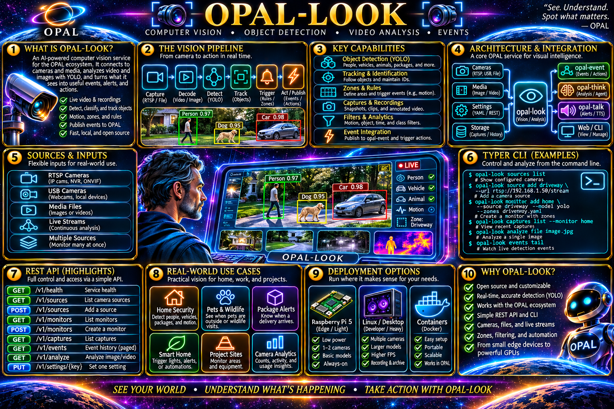

# OPAL Look
### Give your software eyes. Keep the decisions yours.

A camera sees a driveway. A photo lands in a folder. A robot wonders whether the path ahead is clear. In each case, the interesting question is not *where are the pixels?* but **what can we observe, and what should happen next?**

**OPAL Look** is the visual observation service in [OPAL](https://github.com/PatMartin/opal). It turns images and camera frames into structured observations. You can view a feed, run a reusable processing pipeline, retain evidence, or leave a monitor on duty—all through a REST API with a Typer command-line client and a browser console.

~~~text
             Image / uploaded media / RTSP camera
                            |
                            v
                         SOURCE
                            |------> raw frame / live MJPEG view
                            v
                        PIPELINE
                model + transforms + filters
                            |
                            v
                      OBSERVATIONS
                 typed evidence + provenance
                            |
              +-------------+-------------+
              v                           v
          MONITOR                      MEDIA / JOB
       conditions + SSE              capture / record
              |
              v
          OPAL-EVENT  --->  automation / OPAL-THINK / your app
~~~

**No public session management required.** The basic workflows are *view it*, *analyze it*, and *monitor it*. Complex processing remains available when you need it.

> **What is real today?** OPAL Look includes a deterministic **synthetic inference engine** for testing the API, not a trained object detector. It **does not identify people, cars, or animals in actual photographs**. RTSP capture is implemented using PyAV, but real detection requires a separate trained-model adapter. You can [install YOLO and test it independently](#optional-install-yolo-for-real-object-detection) right now; connecting its pixels to OPAL Look still needs a small but essential adapter-interface change. See [Current capabilities and known limitations](#current-capabilities-and-known-limitations).

**Explore:** [Quickstart](#quickstart-in-five-minutes) · [YOLO setup](#optional-install-yolo-for-real-object-detection) · [CLI reference](#complete-cli-reference) · [Recipes](#practical-recipes) · [REST and integrations](#rest-streams-and-opal-integrations) · [Limitations](#current-capabilities-and-known-limitations) · [Contributing](#tests-contract-and-contributing)

---

## Quickstart in five minutes

### 1. Install from a checkout

You need **Python 3.12+**. The commands below use Bash on Linux/macOS. Windows users can create a venv with `py -3.12 -m venv .venv` and activate `.\.venv\Scripts\Activate.ps1` in PowerShell.

~~~bash
git clone https://github.com/PatMartin/opal-look.git
cd opal-look
python3 -m venv .venv
source .venv/bin/activate
python -m pip install -e ".[dev]"
~~~

This is a source-checkout workflow. The project's current wheel packaging lists only `src/opal_look` even though the CLI lives in `src/opal_look_cli`; until that is corrected, verify that `opal-look-cli` is installed before distributing a built wheel.

### 2. Start the service

~~~bash
opal-look
~~~

By default, LOOK listens at **http://127.0.0.1:8000** on loopback. Keep that terminal open. Use a second terminal with the same virtual environment:

~~~bash
opal-look-cli health live
opal-look-cli health ready
opal-look-cli engines list
opal-look-cli models list
opal-look-cli capabilities show
~~~

The built-in inference engine is `synthetic` and its seeded model is `synthetic-vision`. You can also open the browser console at **http://127.0.0.1:8000/app/**.

If port 8000 is already taken, use `OPAL_LOOK_PORT=8002 opal-look` and point the CLI to it:

~~~bash
opal-look-cli --url http://127.0.0.1:8002 health show
~~~

### 3. Create your first processing pipeline

~~~bash
opal-look-cli pipelines add --body '{"id":"demo","name":"First vision pipeline","model_id":"synthetic-vision","task":"detection"}'
opal-look-cli pipelines show demo
~~~

### 4. Analyze an image, without a camera

Put any JPG or PNG in the working directory and call it `sample.jpg`:

~~~bash
opal-look-cli analyze image sample.jpg --request '{"pipeline_id":"demo"}'
~~~

This returns **structured detection-shaped observations**, but the labels are synthetic, not facts about the photo. That's intentional: you can test the REST interface, persistence, CLI, and downstream tools before committing to a hardware or model provider.

You've now exercised **image → pipeline → observations**. No session IDs, no camera credentials, no GPU, no drama.

---

## Optional: install YOLO for real object detection

A deterministic test engine is perfect for building interfaces. At some point, though, you may want to know whether there is *actually* a dog on the porch. That's where a trained vision model comes in.

[Ultralytics YOLO](https://docs.ultralytics.com/quickstart) is one option. It is **optional**: OPAL Look is intended to work with multiple models and vendors, and installing YOLO does not replace its REST API or pipeline abstraction.

### Step A — Install Ultralytics in the Python environment

From the repository directory, with your virtual environment active:

~~~bash
python -m pip install -U ultralytics
~~~

This installs the Ultralytics `yolo` command and its Python dependencies. It may download substantial PyTorch packages. For an NVIDIA GPU, choose a compatible PyTorch/CUDA build using the official [PyTorch installation selector](https://pytorch.org/get-started/locally/) **before** installing Ultralytics if you need control over the CUDA version.

Test whether PyTorch can see your accelerator:

~~~bash
python -c "import torch; print('Torch:', torch.__version__); print('CUDA available:', torch.cuda.is_available()); print('CUDA devices:', torch.cuda.device_count())"
~~~

`CUDA available: False` does **not** mean YOLO cannot run; it means the PyTorch environment is not using CUDA. CPU inference is possible, usually with lower throughput. On an NVIDIA system, verify your driver separately with `nvidia-smi`.

### Step B — Run real inference outside OPAL Look

Use your own picture and a small pretrained model:

~~~bash
yolo predict model=yolo26n.pt source=sample.jpg imgsz=640
~~~

On first use, Ultralytics downloads the model weights. It should save a rendered prediction in a `runs/detect/predict*` directory. This is **real pretrained inference**, unlike LOOK's synthetic engine.

You can also call the model directly from Python:

~~~python
from ultralytics import YOLO

model = YOLO("yolo26n.pt")
results = model.predict(source="sample.jpg", conf=0.25)
for result in results:
    for box in result.boxes:
        print(result.names[int(box.cls.item())], float(box.conf.item()))
~~~

Choose a smaller model and lower resolution to explore CPU/Raspberry Pi performance; measure actual throughput and thermals instead of assuming desktop GPU performance on an edge device.

### Step C — Understand the integration boundary

**Installing `ultralytics` does not automatically register a `yolo` engine in OPAL Look.** As of this revision, the included engine registry only seeds `synthetic`. External engine plugins can register themselves through Python entry points, using the group `opal_look.engines`, but **no Ultralytics adapter is included here**.

More importantly, LOOK's current `EngineAdapter.infer(...)` protocol receives image **width, height, task, model description, options, and frame key**, *not the actual image data*. `pipeline_exec.py` similarly calls it without passing the input pixels. That is sufficient for synthetic test results, **not for real YOLO inference**.

To make YOLO a first-class LOOK engine, the following engineering work is required:

1. Evolve the internal engine-adapter interface to accept the **actual decoded frame** (for example a PIL image), preserving one-decode-per-frame pipeline behavior.
2. Update the synthetic adapter and its tests to use the new interface without breaking existing REST request and response shapes.
3. Implement an Ultralytics adapter: load a configured model once, run inference on the supplied frame, and normalize its boxes, labels, scores, and optional tracking data into LOOK's typed observation payloads.
4. Register the adapter through an `opal_look.engines` Python entry point, then validate its advertised tasks, availability, options, and model resource references.
5. Add deterministic fixture tests, a real-image **evalset**, and CPU/GPU smoke tests. Verify confidence filtering, coordinate normalization, repeated frames, and failure behavior.

**Only after that adapter is installed and discovered** will these CLI commands become meaningful (illustrative future workflow; **not supported by the current checkout**):

~~~bash
# FUTURE WORKFLOW — requires an installed YOLO engine adapter
opal-look-cli engines list
opal-look-cli models add --body '{"id":"yolo-small","engine_id":"yolo","resource_ref":"yolo26n.pt","tasks":["detection"]}'
opal-look-cli pipelines add --body '{"id":"real-detect","name":"Real YOLO detection","model_id":"yolo-small","task":"detection"}'
opal-look-cli analyze image sample.jpg --request '{"pipeline_id":"real-detect"}'
~~~

This is intentional separation of concerns: **YOLO owns inference; OPAL Look owns pipelines, observations, retention, CLI, and REST**. An Ultralytics license may carry **AGPL-3.0 obligations**; consult [Ultralytics licensing](https://docs.ultralytics.com/) and seek appropriate advice before distributing proprietary or commercial solutions. An Enterprise license is also offered.

---

## Understand the building blocks

| Resource | What it represents | Why you care |
|---|---|---|
| **Sources** | RTSP feed, host image, file, or uploaded media reference | A named place to look |
| **Engines** | Installed inference provider / adapter | Interchangeable implementation |
| **Models** | Registered resource belonging to an engine | Which model to execute |
| **Pipelines** | One model/task or an ordered DAG of stages | Reusable way to process frames |
| **Observations** | Typed, traceable output from a pipeline | What the system observed |
| **Monitors** | Durable source + pipeline + inline conditions | Continuous watch with restart behavior |
| **Media** | Uploaded content, retained captures, derived artifacts | Evidence you can retrieve |
| **Jobs** | Finite, queued background processing | Batch work without blocking a request |
| **Recordings** | Explicit live recording lifecycle | Save a feed independently of monitoring |

**Current contract (v1.6.0):** sessions, profiles, zones, rules, captures, artifacts and personas are first-class resources; collection paths are singular (`/api/v1/source/`, `/api/v1/session/` …); personas are named observer identities that may bind an OPAL Say `voice_id`.

---

## Complete CLI reference

There are **two executables**:

- `opal-look` starts the **service**.
- `opal-look-cli` talks to the service over **REST**.

Every command below is derived from the checked-in [Typer implementation](src/opal_look_cli/cli.py), not from a hypothetical CLI. **Some legacy generic CRUD verbs still appear in `--help` even when REST does not support the operation.** They are marked `!` so you don't waste time trying them. `*` indicates a [currently defective streaming-client path](#live-streams-and-the-browser).

### Global flags and common patterns

~~~bash
opal-look-cli --help
opal-look-cli --url http://127.0.0.1:8002 --json sources list
opal-look-cli sources --help
opal-look-cli monitors add --file monitor.json
~~~

| Flag | Usage |
|---|---|
| `--url URL` | Server base URL; default `http://127.0.0.1:8000` |
| `--json` | JSON output for scripts and `jq` |
| `--body 'JSON'` | Inline request object |
| `--file FILE` | Load a JSON request object from disk |
| `--out FILE` | Save returned binary data |
| `--pipeline ID` | Select a pipeline on applicable source commands |
| `--idempotency-key KEY` | Avoid duplicate job submission |

Put global flags **before the command group**. Prefer `--file` for substantial JSON, especially on Windows and for reviewable workflows.

### The complete Typer command tree

`!` = command currently exposed by a generic CLI builder, but without the corresponding supported REST operation. `*` = streaming command with the currently known HTTPX client defect.

~~~text
opal-look-cli [--url URL] [--json]
|
+-- info
+-- capabilities
|   +-- show
+-- health
|   +-- show
|   +-- live
|   +-- ready
+-- metrics
|   +-- show
+-- events
|   +-- status
|
+-- engines
|   +-- list
|   +-- show ENGINE_ID
|   +-- update ENGINE_ID [--body JSON | --file FILE]
|   +-- add !                  no engine creation API
|   +-- remove !               no engine deletion API
|
+-- models
|   +-- list
|   +-- show MODEL_ID
|   +-- add [--body JSON | --file FILE]
|   +-- update MODEL_ID [--body JSON | --file FILE]
|   +-- remove MODEL_ID
|
+-- sources
|   +-- list
|   +-- show SOURCE_ID
|   +-- add [--body JSON | --file FILE]
|   +-- update SOURCE_ID [--body JSON | --file FILE]
|   +-- remove SOURCE_ID
|   +-- status SOURCE_ID
|   +-- probe SOURCE_ID
|   +-- frame SOURCE_ID [--out FILE]
|   +-- view SOURCE_ID [--out FILE] [--max-bytes N] [--pipeline ID] *
|   +-- observe SOURCE_ID *
|   +-- capture SOURCE_ID [--pipeline ID] [--annotated]
|
+-- pipelines
|   +-- list
|   +-- show PIPELINE_ID
|   +-- add [--body JSON | --file FILE]
|   +-- update PIPELINE_ID [--body JSON | --file FILE]
|   +-- remove PIPELINE_ID
|   +-- validate [--body JSON | --file FILE]
|
+-- analyze
|   +-- run [--body JSON | --file FILE]
|   +-- image FILE [--request JSON]
|
+-- monitors
|   +-- list
|   +-- show MONITOR_ID
|   +-- add [--body JSON | --file FILE]
|   +-- update MONITOR_ID [--body JSON | --file FILE]
|   +-- remove MONITOR_ID
|   +-- stream MONITOR_ID *
|
+-- observations
|   +-- list
|   +-- show OBSERVATION_ID
|   +-- add !                  observations are generated by analysis
|   +-- update !               no observation PATCH API
|   +-- remove !               no observation DELETE API
|
+-- media
|   +-- list
|   +-- show MEDIA_ID
|   +-- upload FILE [--ttl SECONDS]
|   +-- download MEDIA_ID [--out FILE]
|   +-- remove MEDIA_ID
|   +-- add !                  POST requires multipart upload
|   +-- update !               no media PATCH API
|
+-- jobs
|   +-- list
|   +-- show JOB_ID
|   +-- submit [--body JSON | --file FILE] [--idempotency-key KEY]
|   +-- cancel JOB_ID
|   +-- add !                  use submit
|   +-- update !               no job PATCH API
|   +-- remove !               no job DELETE API
|
+-- recordings
|   +-- list
|   +-- show RECORDING_ID
|   +-- start --source SOURCE_ID [--pipeline ID] [--duration SECONDS]
|   +-- stop RECORDING_ID
|   +-- add !                  use start
|   +-- update !               no recording PATCH API
|   +-- remove !               no recording DELETE API
|
+-- settings
|   +-- list
|   +-- show KEY
|   +-- set KEY JSON_VALUE
|   +-- reset KEY
|   +-- remove KEY             alternative to reset
|   +-- add !                  no settings POST API
|   +-- update !               no settings/key PATCH API
|
+-- configuration
    +-- export
    +-- validate --file FILE
    +-- import --file FILE [--bindings FILE]
~~~

**One important rule:** successful `--help` output is *not* proof a command exists in REST. The generic builder currently generates invalid aliases. The goal is CLI/REST parity; the table records the real current state until parity fixes land.

### Quick task lookup

| Your goal | CLI command |
|---|---|
| Is LOOK running? | `health ready` |
| What can my installation do? | `capabilities show` |
| What inference engines are installed? | `engines list` |
| What models can I select? | `models list` |
| What cameras/sources are configured? | `sources list` |
| Is this RTSP feed reachable? | `sources probe driveway` |
| Fetch one fresh frame | `sources frame driveway --out frame.jpg` |
| Create a pipeline | `pipelines add --file pipeline.json` |
| Inspect a pipeline | `pipelines show PIPELINE_ID` |
| Process a still image | `analyze image photo.jpg --request '{"pipeline_id":"demo"}'` |
| Process an uploaded media item | `analyze run --file request.json` |
| Arm a permanent lookout | `monitors add --file monitor.json` |
| Read retained observations | `observations list` |
| Upload a picture | `media upload picture.jpg` |
| Save the latest frame | `sources capture driveway` |
| Record camera video | `recordings start --source driveway --duration 30` |
| Inspect a background job | `jobs show JOB_ID` |
| Set one configuration value | `settings set max_preview_fps 2` |
| Export configuration | `configuration export` |
| Inspect metrics | `metrics show` |

---

## Practical recipes

The examples deliberately start with tools that work **without GPU or a trained model**. Recipes requiring an actual camera or model say so explicitly.

### 1. A miniature vision laboratory

~~~bash
opal-look-cli pipelines add --body '{"id":"lab","name":"Portable vision lab","model_id":"synthetic-vision","task":"detection","retention":{"persist_observations":true,"ttl_seconds":3600}}'
opal-look-cli analyze image sample.jpg --request '{"pipeline_id":"lab"}'
opal-look-cli observations list
~~~

Use `observations show OBSERVATION_ID` to inspect a retained observation. Without retention opt-in, a result returned to the caller may not be stored.

### 2. Upload once, analyze repeatedly

~~~bash
opal-look-cli media upload sample.jpg --ttl 86400
opal-look-cli media list
opal-look-cli media show MEDIA_ID

opal-look-cli analyze run --body '{"source":{"media_id":"MEDIA_ID"},"pipeline_id":"lab"}'

opal-look-cli media download MEDIA_ID --out recovered.jpg
~~~

`MEDIA_ID` is the returned upload ID. The upload route currently handles supported images; don't assume it can ingest arbitrary MP4 content.

### 3. Name an input so your workflows can reuse it

~~~bash
opal-look-cli sources add --body '{"id":"example-photo","kind":"media","name":"Lab sample","locator":"MEDIA_ID"}'
opal-look-cli sources show example-photo
opal-look-cli sources frame example-photo --out single-frame.jpg
opal-look-cli analyze run --body '{"source":{"source_id":"example-photo"},"pipeline_id":"lab"}'
~~~

A source is a reference to frames; a media record is retained content. They are not interchangeable resources.

### 4. Stack processing stages

For advanced processing, place the request in `pipeline.json`:

~~~json
{
  "id": "grayscale-lab",
  "name": "Grayscale before inference",
  "stages": [
    {
      "id": "gray",
      "kind": "filter",
      "portable": { "filter": { "type": "grayscale" } }
    },
    {
      "id": "detect",
      "kind": "inference",
      "model_id": "synthetic-vision",
      "task": "detection",
      "inputs": ["gray"]
    }
  ]
}
~~~

~~~bash
opal-look-cli pipelines validate --file pipeline.json
opal-look-cli pipelines add --file pipeline.json
opal-look-cli pipelines show grayscale-lab
opal-look-cli analyze image sample.jpg --request '{"pipeline_id":"grayscale-lab"}'
~~~

The executor supports an ordered DAG of filters, inference, transforms, tracking, and presentation. Stage input IDs must reference earlier stages, and capabilities vary by adapter. Available portable filter types include grayscale, blur, threshold, edges, sharpen, rotate, flip, crop, resize, brightness/contrast, and motion.

### 5. Bring a driveway camera online

Replace the documentation-only address with your own reachable RTSP URL:

~~~bash
opal-look-cli sources add --body '{"id":"driveway","kind":"rtsp","name":"Driveway camera","locator":"rtsp://192.0.2.10:554/stream1"}'

opal-look-cli sources probe driveway
opal-look-cli sources frame driveway --out driveway.jpg
opal-look-cli sources status driveway
~~~

RTSP access is backed by PyAV. A source may be configured even while the network endpoint is offline; `probe` is a bounded connectivity check, while `frame` retrieves a still image.

**Do not embed camera credentials in URLs.** To reference a server-provisioned credential, use `secret_ref`:

~~~bash
opal-look-cli sources add --body '{"id":"front-door","kind":"rtsp","name":"Front door","locator":"rtsp://192.0.2.20:554/stream1","secret_ref":"front_door"}'
~~~

Before starting the server, provision `OPAL_LOOK_CRED_FRONT_DOOR` as `username:password` in its environment. Avoid committing credentials or placing them in shell history.

**Known issue:** source `status` still consults old internal session state and may not reflect a live monitor or viewer. Prefer `probe` and `frame` for connectivity testing for now.

### 6. Watch without creating a session

The source REST endpoint streams multipart MJPEG, optionally through a selected pipeline:

~~~bash
# Raw camera stream
curl --no-buffer http://127.0.0.1:8000/api/v1/sources/driveway/stream

# Stream through the named pipeline (synthetic inference for now)
curl --no-buffer 'http://127.0.0.1:8000/api/v1/sources/driveway/stream?pipeline_id=lab&annotations=true'
~~~

The CLI exposes:

~~~bash
opal-look-cli sources view driveway --pipeline lab --out driveway.mjpeg --max-bytes 5000000
~~~

**Current defect:** the CLI streaming wrapper passes an unsupported `stream=True` parameter to HTTPX. The CLI command requires a fix; use the REST endpoint with a proper streaming client meanwhile. The REST response is multipart MJPEG, not a single JPEG image.

### 7. Mark a useful part of the picture

Sources own zones, expressed as normalized coordinates in the range 0–1. This is an example polygon; adjust coordinates for your camera perspective:

~~~bash
opal-look-cli sources update driveway --body '{"zones":[{"id":"driveway-area","name":"Driveway area","kind":"polygon","points":[{"x":0.12,"y":0.44},{"x":0.87,"y":0.43},{"x":0.94,"y":0.94},{"x":0.08,"y":0.95}]}]}'
~~~

Zones are source-local. Polygons require at least three points, lines exactly two.

### 8. Put a lookout on duty

A monitor combines a source, pipeline, and conditions. It is durable desired state: it can restart without a client holding a session open.

~~~bash
opal-look-cli monitors add --body '{"id":"driveway-watch","name":"Driveway lookout","source_id":"driveway","pipeline_id":"lab","enabled":true,"restart_policy":"on_failure","conditions":[{"id":"visitor","event":"object_appears","classes":["person"],"cooldown_ms":5000,"capture_on_match":true}]}'

opal-look-cli monitors list
opal-look-cli monitors show driveway-watch
opal-look-cli monitors update driveway-watch --body '{"enabled":false}'
~~~

With the bundled `synthetic-vision` engine, person labels are **not actual camera detections**. Use a real detector before driving security alerts or physical actions. Supported condition types include `object_appears`, `object_disappears`, `enters_zone`, `exits_zone`, `line_crosses`, `count_threshold`, `dwell_time`, and `motion_detected`, subject to pipeline and tracking support.

**Current defect:** changing a running monitor's pipeline/conditions may not restart its worker. Stop/re-enable and verify before relying on revised conditions; the lifecycle needs hardening.

### 9. Subscribe to an observation stream

~~~bash
# These Typer commands exist, but currently need the HTTPX streaming fix:
opal-look-cli sources observe driveway
opal-look-cli monitors stream driveway-watch

# Current REST/SSE alternative:
curl -N 'http://127.0.0.1:8000/api/v1/sources/driveway/observations/stream?pipeline_id=lab'
curl -N http://127.0.0.1:8000/api/v1/monitors/driveway-watch/observations/stream
~~~

Source observation SSE is connection-scoped and transient. Monitor SSE offers a bounded replay window using `Last-Event-ID`. Neither should be mistaken for unlimited guaranteed-delivery messaging.

### 10. Save a frame instead of a whole recording

~~~bash
opal-look-cli sources capture driveway
opal-look-cli sources capture driveway --pipeline lab --annotated
opal-look-cli media list
opal-look-cli media download MEDIA_ID --out snapshot.jpg
~~~

Captures produce retained media and do not require a public session.

### 11. Record a camera independently of monitoring

~~~bash
opal-look-cli recordings start --source driveway --duration 30
opal-look-cli recordings list
opal-look-cli recordings show RECORDING_ID
opal-look-cli recordings stop RECORDING_ID
~~~

The current recorder writes **MJPEG-like JPEG-frame output**; it does not supply general MP4/WebM encoding or audio capture. Find the returned media ID to retrieve the output.

### 12. Submit a bounded background job

~~~bash
opal-look-cli jobs submit --body '{"kind":"media_export","media_id":"MEDIA_ID","output":{"format":"png"}}' --idempotency-key image-export-001
opal-look-cli jobs list
opal-look-cli jobs show JOB_ID
opal-look-cli jobs cancel JOB_ID
~~~

`video_analysis` jobs are also defined but currently have image-oriented decoder limitations; they are not general-purpose MP4 analysis.

### 13. Change a single setting

~~~bash
opal-look-cli settings list
opal-look-cli settings show max_preview_fps
opal-look-cli settings set max_preview_fps 2
opal-look-cli settings reset max_preview_fps

# Default pipeline for analysis requests that omit one:
opal-look-cli settings set default_pipeline_id '"lab"'
opal-look-cli analyze image sample.jpg
~~~

`set` parses its last argument as **JSON**. Numbers are bare (e.g. `2`); strings need quotes (e.g. `'"lab"'`). Setting event publication on requires a provisioned event transport.

### 14. Export and validate configuration

~~~bash
opal-look-cli configuration export > look-config.json
opal-look-cli configuration validate --file look-config.json
opal-look-cli configuration import --file look-config.json
~~~

Sensitive source locators are redacted in exports. For portability, `configuration import --bindings bindings.json` can explicitly rebind environment-specific source details. Validate imports and avoid putting secrets in configuration files.

### 15. Find out what is running

~~~bash
opal-look-cli info
opal-look-cli health show
opal-look-cli health live
opal-look-cli health ready
opal-look-cli metrics show
opal-look-cli events status
opal-look-cli capabilities show
~~~

Capability discovery exists, but several boolean fields currently remain hard-coded false even when supporting code is present. Treat those specific flags as work in progress until they are reconciled with actual installed adapters and runtime state.

---

## REST, streams, and OPAL integrations

The pinned [OpenAPI v1.6.0 specification](openapi/opal_look_v1.6.0.yaml) plus the shared [OPAL Suite Kernel](openapi/shared/opal_kernel.yaml) define **63 paths / 98 operations**. The old v1.4.0-era specification stays under `vendor/opal-api/` for comparison.

### The main REST surface

| Goal | Request |
|---|---|
| Capabilities | `GET /api/v1/capabilities/` |
| Engines / models | `GET /api/v1/engine/` / `GET /api/v1/model/` |
| Source list | `GET /api/v1/source/` |
| Single frame | `GET /api/v1/source/{source_id}/frame` |
| MJPEG view | `GET /api/v1/source/{source_id}/stream` |
| Capture | `POST /api/v1/source/{source_id}/capture/` |
| Pipelines | `GET /api/v1/pipeline/` |
| Pipeline validation | `POST /api/v1/pipeline/validate` |
| Image analysis | `POST /api/v1/analyze/image` |
| Source/media analysis | `POST /api/v1/analyze/` |
| Sessions | `GET|POST /api/v1/session/` |
| Monitors | `GET /api/v1/monitor/` |
| Observations | `GET /api/v1/observation/` |
| Media | `GET /api/v1/media/` |
| Jobs | `POST /api/v1/job/` |
| Recordings | `POST /api/v1/recording/` |
| Personas | `GET|POST /api/v1/persona/` |
| Settings | `GET /api/v1/setting/` |
| Export configuration | `GET /api/v1/configuration/export` |
| Health | `GET /api/v1/health/` |
| Service info | `GET /api/v1/info/` |

Trailing slashes on collection endpoints matter; match the OpenAPI file exactly.

~~~bash
curl -sS http://127.0.0.1:8000/api/v1/health/

curl -sS -X POST http://127.0.0.1:8000/api/v1/analyze/ \
  -H 'Content-Type: application/json' \
  -d '{"source":{"media_id":"MEDIA_ID"},"pipeline_id":"lab"}'
~~~

When bearer authentication is configured, also send `Authorization: Bearer <token>`. For mutation calls, follow the contract's configuration-ETag / `If-Match` rules; the supported CLI mutation wrappers handle that step.

### What happens when a monitor matches?

~~~text
camera --> OPAL Look monitor --> condition match --> OPAL Event
                                                        |
                               +------------------------+----------------+
                               v                        v                v
                         notification               webhook        OPAL Think
~~~

LOOK observes; OPAL-EVENT handles enabled actions and integrations. Publication is disabled by default and is best-effort. LOOK must remain useful even when the event bus is not configured.

### Live streams and the browser

The SPA is available at **`/app/`**. It exposes sources, pipelines, analysis, viewing, monitors, media, jobs, recordings, configuration, and diagnostics through REST.

The **REST MJPEG implementation** and **SPA viewer** are not equally mature: the current SPA assembles arbitrary network chunks into JPEG blobs rather than correctly parsing multipart frame boundaries, and its stream cancellation needs work. Until corrected, test live video with a proper MJPEG-aware viewer or client. The CLI stream path also needs the HTTPX fix documented above.

---

## Configuration, security, and lightweight hardware

| Server variable | Purpose |
|---|---|
| `OPAL_LOOK_HOST` | Bind address; defaults to `127.0.0.1` |
| `OPAL_LOOK_PORT` | HTTP port; defaults to `8000` |
| `OPAL_LOOK_TOKEN` | Opaque bearer token; required for non-loopback bind through the normal entry point |
| `OPAL_LOOK_CRED_<NAME>` | Credential for a corresponding `secret_ref` |
| `OPAL_LOOK_EVENT_TRANSPORT` | Event transport provisioned out-of-band |

Start on loopback. For network access, add suitable authentication, TLS at a reverse proxy, and firewall policy. Never put credentials in source locators, logs, public screenshots, or source control.

**A GPU is optional for the API and synthetic engine.** For small edge devices, reduce FPS, resolution, active viewers, and retention before trying a large model:

~~~bash
opal-look-cli settings set max_preview_fps 2
opal-look-cli settings set max_viewers 2
opal-look-cli settings set max_monitors 1
~~~

Be aware that viewing, recording, and monitoring can currently open independent capture connections to the same camera, which increases CPU and bandwidth use. Design for modest hardware first; scale up when actual measurement justifies it.

---

## Current capabilities and known limitations

These are honest distinctions between an implemented REST surface and an end-to-end feature demonstrated on real hardware.

| Area | Current state |
|---|---|
| API-first sources, models, pipelines, monitors | Implemented |
| Typed observations, retention, captures, media | Implemented |
| One-shot image analysis | Implemented; synthetic inference bundled |
| Ordered filters, DAG validation, motion processing | Implemented |
| RTSP capture using PyAV | Implemented; test against your camera |
| Raw/processed REST MJPEG viewing and SSE | Implemented; more soak testing needed |
| Monitor conditions and event publication | Implemented; monitor reconfiguration needs hardening |
| Finite jobs and MJPEG-like recordings | Implemented within current decoder/encoder limitations |
| Trained-model inference / YOLO | **Not bundled**; requires image-aware adapter interface |
| USB cameras and HTTP camera feeds | Capture adapters required |
| General MP4/WebM processing or audio recording | Not fully implemented |
| CLI live view and SSE | Known HTTPX streaming error |
| SPA live MJPEG | Known multipart parsing / cancellation issues |
| Source status | May not represent active sessionless viewers/monitors |
| Capability discovery | Some hard-coded flags underreport support |
| Clean CI | Latest verified main run was blocked by missing `PyYAML` dependency |
| Full OpenAPI compliance | Route presence alone doesn't prove schema or runtime compliance |

The pinned REST contract is **v1.6.0** (`openapi/opal_look_v1.6.0.yaml` + kernel 1.6.0); the service reports `contract_version: "1.6.0"`. The [v1.6 ledger](specs/OPAL_LOOK_V1_6_LEDGER.md) describes the current revision; the [v1.5 notes](specs/OPAL_LOOK_V1_5_MIGRATION.md) and [ledger](specs/OPAL_LOOK_V1_5_LEDGER.md) document the previous migration.

---

## Tests, contract, and contributing

~~~bash
python -m pytest -q
python -m opal_look.contract_audit
python -m opal_look.contract_audit --strict
~~~

The audit verifies the route inventory against the pinned YAML. It does **not** validate every response body, long-running stream, camera, or model provider.

**CI note:** The latest verified clean run failed during collection because `PyYAML` was missing from development dependencies; `python -m pip install PyYAML` is a temporary local workaround until packaging is fixed. Some migration-era audit tests also appear to have outdated expectations. A green test suite must be re-established before the next release.

The code is intentionally organized for small, independently testable changes:

| Explore | File |
|---|---|
| FastAPI setup | [`src/opal_look/app.py`](src/opal_look/app.py) |
| CLI implementation | [`src/opal_look_cli/cli.py`](src/opal_look_cli/cli.py) |
| Browser UI | [`src/opal_look/static/app.js`](src/opal_look/static/app.js) |
| Pipeline execution | [`src/opal_look/pipeline_exec.py`](src/opal_look/pipeline_exec.py) |
| Engine adapter protocol | [`src/opal_look/engines.py`](src/opal_look/engines.py) |
| Capture adapters | [`src/opal_look/capture.py`](src/opal_look/capture.py) |
| RTSP implementation | [`src/opal_look/capture_rtsp.py`](src/opal_look/capture_rtsp.py) |
| Monitor workers | [`src/opal_look/monitors.py`](src/opal_look/monitors.py) |
| REST contract audit | [`src/opal_look/contract_audit.py`](src/opal_look/contract_audit.py) |

Follow [`AGENTS.md`](AGENTS.md), keep the REST contract authoritative, derive CLI and SPA behavior from the server, and make **one cohesive change per commit**. Report passed, failed, skipped, and unexecuted tests—and be explicit about limitations.

> **OPAL design tenets:** Be promiscuous about compatible integrations. Standardize interfaces, not implementations. Make useful intelligence available on the hardware people already own. Explore without limits; design with discipline; implement with restraint; validate with evidence.

**OPAL Look is where pixels become useful observations.** Start with a picture. Add a camera when you're ready. Add a real model when the application needs one. Keep everything loosely coupled so the next provider, device, or idea can join the conversation.

[OPAL](https://github.com/PatMartin/opal) · [OPAL Listen](https://github.com/PatMartin/opal-listen) · [OPAL Event](https://github.com/PatMartin/opal-event) · [OPAL Talk](https://github.com/PatMartin/opal-talk) · [OPAL Think](https://github.com/PatMartin/opal-think)
